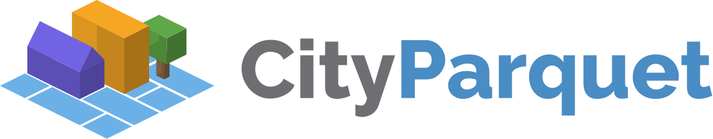

  

  <b>Open encodings and tools for 3D city models</b>

  <a href="https://www.cityjson.org">Website</a> ·
  <a href="https://www.cityjson.org/specs/">Specifications</a> ·
  <a href="https://www.cityjson.org/software/">Software</a> ·
  <a href="https://www.cityjson.org/datasets/">Datasets</a>

---

CityJSON is a JSON-based encoding of the CityGML data model, an OGC Community Standard for
storing and exchanging 3D city models: buildings, roads, vegetation and terrain, with their
semantics. This organisation hosts the specification and a family of formats and tools built
around it, from a streaming variant to cloud-native encodings that are queried in place over
HTTP.

## The format family

<table>
  <tr>
    <td align="center" width="33%">
      
    </td>
    <td align="center" width="33%">
      
    </td>
    <td align="center" width="33%">
      
    </td>
  </tr>
  <tr>
    <td valign="top">
      <b>CityJSON</b> and <b>CityJSONSeq</b>: the JSON encoding of CityGML, and its
      line-delimited streaming form.
    </td>
    <td valign="top">
      <b>FlatCityBuf</b>: a cloud-optimised binary encoding in FlatBuffers, with spatial and
      attribute indices for HTTP range requests.
    </td>
    <td valign="top">
      <b>CityParquet</b>: a columnar encoding in Parquet, queryable where it lies on object
      storage with no server.
    </td>
  </tr>
</table>

## Representative repositories

**Specifications**

- [specs](https://github.com/cityjson/specs): the CityJSON specification
- [extensions](https://github.com/cityjson/extensions): the registry of CityJSON Extensions
- [stac-city3d](https://github.com/cityjson/stac-city3d): STAC extension for 3D city models

**Formats**

- [flatcitybuf](https://github.com/cityjson/flatcitybuf): FlatCityBuf, with readers in Rust, C++, Python and TypeScript
- [cityparquet](https://github.com/cityjson/cityparquet): the CityParquet specification and its Rust reference implementation
- [cjseq](https://github.com/cityjson/cjseq): create, process and convert CityJSONSeq

**Tools**

- [cjio](https://github.com/cityjson/cjio): Python CLI to process and manipulate CityJSON files
- [cjval](https://github.com/cityjson/cjval): the official validator for CityJSON and CityJSONSeq
- [convert](https://github.com/cityjson/convert): convert between CityJSON, CityJSONSeq, FlatCityBuf, CityParquet and OBJ, [in the browser](https://cityjson.github.io/convert/)
- [cjdb](https://github.com/cityjson/cjdb): load CityJSON into PostgreSQL

**Viewers and plugins**

- [ninja](https://github.com/cityjson/ninja): a web viewer for CityJSON, [ninja.cityjson.org](https://ninja.cityjson.org)
- [cityjson-qgis-plugin](https://github.com/cityjson/cityjson-qgis-plugin): CityJSON support for QGIS
- [RhinoCityJSON](https://github.com/cityjson/RhinoCityJSON): CityJSON in Rhino and Grasshopper
- [cityjson-threejs-loader](https://github.com/cityjson/cityjson-threejs-loader): a three.js loader

**DuckDB extensions** (experimental)

- [duckdb-cityjson](https://github.com/cityjson/duckdb-cityjson): read and write CityJSON, CityJSONSeq, FlatCityBuf and CityParquet in SQL
- [duckdb-3d](https://github.com/cityjson/duckdb-3d): 3D solid processing in SQL

**Discovery**

- [city3d-stac-tool](https://github.com/cityjson/city3d-stac-tool): generate STAC catalogues for 3D city models
- [open3d-cm-catalog](https://github.com/cityjson/open3d-cm-catalog): the Open 3D City Model Catalog
